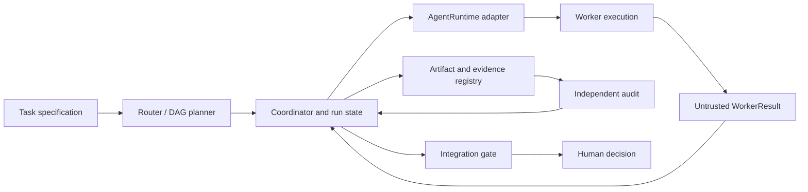

# ADR-001: límites del runtime, evidencia y decisión de integración

- **Estado:** aceptado como arquitectura incremental de esta rama de trabajo
- **Fecha:** 2026-11-02
- **Contexto:** el baseline `908e35637518c4c1ab56c1f75138d194cadd3938` ya incluye scripts CLI, perfiles, runners experimentales, worktrees y un gate mecánico. El P0 identifica handoffs autodeclarados, falta de procedencia en checks y ausencia de la etapa de revisión en el runner de build.

## Decisión

Mantener SSEC como una herramienta local ligera con un núcleo Python tipado y providers opcionales detrás de una interfaz `AgentRuntime`. Un coordinador único crea las tareas, controla el DAG, inicia procesos/sesiones, valida Worker Results y Run Events, y deriva el estado canónico. El contenido y el mailbox del worker son datos no confiables. El worker puede proponer diffs y hallazgos; no puede producir por sí mismo `REVIEW_ACCEPTED`, `TEST_PASS` o `RELEASE_READY`.

## Contratos versionados

El núcleo define versiones y validación estricta para `TaskPacket`, `WorkerResult`, `AuditReport`, `RunEvent`, `EvidenceRecord` y `ReleaseDecision`. Los campos mínimos son:

- **TaskPacket:** `schema_version`, `task_id`, `task_revision`, objetivo, riesgo, obligaciones, inputs con hashes, `base_commit`, archivos permitidos/propiedad, outputs, dependencias, pruebas y criterios de aceptación. El packet es inmutable durante esa revisión; la petición externa se marca como dato, no autoridad de sistema.
- **WorkerResult:** proveedor/runtime, `run_id`, `task_revision`, rol, estado de proceso, commit/base, inputs consumidos, paths/diff hashes, comandos y logs declarados, hallazgos, limitaciones y propuesta. Es una declaración hasta que el coordinador valida cada referencia.
- **RunEvent:** secuencia monotónica, evento, actor/owner, `run_id`, timestamp UTC y referencia al resultado. Solo el coordinador altera estado canónico. Mailbox JSONL conserva mensajes entrantes no confiables.
- **EvidenceRecord:** tipo de check, argv estructurado, cwd/commit/input hash, environment, hora, timeout, exit code, paths de stdout/stderr, hashes y estado calculado por el coordinador. Un SHA-256 identifica bytes; no autentica por sí solo proceso, cuenta, revisor ni contenido científico.
- **AuditReport:** diff/base exactos, packet y resultado revisados, contexto/runtime del auditor, severidad, evidencia de test, independencia declarada y límites. El primer juicio del auditor no recibe la opinión de aceptación como premisa.
- **ReleaseDecision:** estado derivado (`BLOCKED`, `NEEDS_HUMAN`, `READY_FOR_MANUAL_REVIEW`, etc.), obligaciones cumplidas/faltantes, referencias de evidencia y una decisión humana separada. Nunca deriva aprobación final de un exit code 0.

Los schemas son compatibles por versión explícita; migraciones leen el schema anterior y escriben el nuevo de forma controlada. Un JSON arbitrario que contenga una palabra de estado no basta para avanzar el estado canónico.

## Límites por componente

| Componente | Responsabilidad |
|---|---|
| Núcleo/domain | Tipos, validación de schemas, políticas y transición de estados. No importa Tkinter, proveedores, red ni bibliotecas científicas opcionales. |
| Router/planner | Seleccionar solo especialistas necesarios y producir DAG con dependencias, tests, ownership y aceptación. Concurrencia se limita con semáforo en el coordinador, no en el manifiesto. |
| `AgentRuntime` | `discover_capabilities`, `launch`, `stream_or_collect`, `cancel`, `timeout`, `status`, `cleanup`. Entrega eventos crudos de runtime y capacidades detectadas; no eleva estado SSEC. |
| Adaptadores | Codex y Gemini viven en módulos opcionales. Detectan versión/flags efectivos (`--version`, `--help`), registran error claro cuando falta CLI/cuenta/permisos y envían solo el proveedor elegido. `FakeRuntime` cumple el mismo contrato en CI sin red ni costo. |
| Ejecución de worker | Cada implementación obtiene worktree/rama de base fijada. El permiso de archivo se valida en diff y, cuando el runtime lo permita, en el sandbox real. Una instrucción de prompt no sustituye un control técnico. |
| Estado/evidencia | El coordinador persiste transiciones y referencias a artefactos. Retrys usan claves idempotentes; reinicios recuperan estado. Hashes aportan integridad de bytes y detección de cambios, no identidad criptográfica ni resistencia a un actor con escritura sobre el almacén. |
| Revisión/auditoría | Tests deterministas corren después del implementer y antes del reviewer. El reviewer se invoca desde un contexto nuevo con diff y hashes fijados. Si el provider no muestra evidencia de contexto separado, se reporta secuencial/no independiente. |
| Integración/humano | El gate revisa estado, diff, ownership, resultados, conflictos y evidencia. Ambigüedad/colisión va a `NEEDS_HUMAN`. Primeras versiones no hacen merge; release y publicación conservan decisión humana. |
| Módulos científicos | Se cargan bajo demanda, fuera del núcleo. Mantienen `SOFTWARE_VALIDITY`, `NUMERICAL_VALIDITY` y `SCIENTIFIC_VALIDITY` separados. |
| GUI | Supervisor local usa servicios del núcleo; GUI visible no bloquea el event loop. Headless no acredita visibilidad/accesibilidad. |

## Opciones consideradas

1. **Extender los scripts actuales con más campos JSON y condiciones.** Tiene bajo costo inicial y continuidad, pero deja routing, estado, evidencia, procesos y CLI unidos; el baseline ya muestra estados que dependen de declaraciones. Se mantiene como capa de compatibilidad y migración, no como límite final.
2. **Núcleo Python pequeño + contratos versionados + adaptadores locales de runtime y almacén de evidencia — elegida.** Reutiliza Python estándar, runners y worktrees actuales; permite probar Codex-only, Gemini-only y `both` con FakeRuntime sin instalar proveedores. Agrega trabajo de migración y no ofrece aislamiento de SO por sí sola; esa garantía pertenece al sandbox efectivo del runtime/host.
3. **Servicio central, base de datos y cola distribuida.** Facilitaría identidades remotas y concurrencia multiusuario, pero impondría infraestructura, retención y manejo de secretos que el caso local actual no requiere. Se aplaza hasta que exista un requisito multiusuario/deployment demostrado.

## Consecuencias y migración

- Preservar CLI y documentación existentes mientras cada estado de preparación, proceso, resultado validado y decisión tenga nombre distinto.
- P1 empieza con test-first de falsificación de `REVIEW_ACCEPTED`/`TEST_PASS` y procedencia de evidencia; después introduce el runtime SPI y el scheduler/recovery.
- Los adaptadores no instalarán CLIs, cambiarán configuración global ni inspeccionarán/extraerán credenciales automáticamente. Una invocación real de modelo sigue siendo opt-in y puede costar.
- Las capacidades de subagentes de Codex/Gemini se detectan por runtime. Un proceso CLI top-level no se etiqueta como subagente nativo; los adapters deben observar y correlacionar la delegación real o informar `NOT_RUN`.
- Los worktrees separan árboles Git. No separan por sí mismos cuentas, secretos, red, procesos hijos ni sistema operativo.
- La migración es incremental y reversible: conservar lectores de `schema_version` anterior, escribir a nuevos contratos y mantener pruebas de contrato por versión. No crear bases de datos o dependencias científicas hasta que un módulo P2 las justifique.
- Excepción acotada: coordinator state v3 rechaza state v2 y exige re-inicializar la tarea; v2 no guardaba `audit_level` ni permitía validar el inventario completo de workers. No se puede reconstruir esa política de manera confiable a partir del state mutable. Reusar su task ID requiere revisar y limpiar manualmente worktrees/branches/metadata viejos; no se eliminan automáticamente. La migración/recuperación de ramas antiguas queda pendiente de P1; esta ruptura aplica antes de un release y se reporta como tal.

## Evidencia y referencias

- Baseline y defectos reproducibles: [`BASELINE_AUDIT.md`](../audits/BASELINE_AUDIT.md).
- Contrato de la misión: [`CODEX_MASTER_MISSION.md`](../CODEX_MASTER_MISSION.md).
- La documentación vigente describe subagentes en [Codex](https://learn.chatgpt.com/docs/agent-configuration/subagents) y [Gemini CLI](https://geminicli.com/docs/core/subagents/); la invocación SSEC y el evento de delegación todavía requieren pruebas de contrato.
- Revisar esta ADR si el proyecto se vuelve multiusuario/remoto, necesita un almacén con autenticidad criptográfica, o los runtimes no pueden satisfacer los métodos del SPI.
