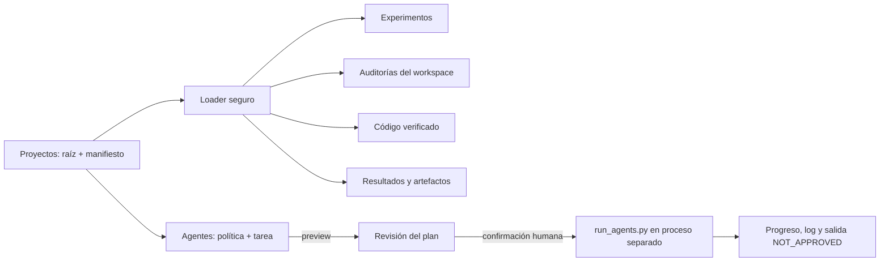

# Diseño P3.18 — Centro de Control Qt integrado

## Objetivo

Ofrecer una sola aplicación PySide6 que reúna el selector de proyectos, el supervisor local de agentes y el workspace científico dinámico. Los contratos, cálculos, loader seguro y runner permanecen en los módulos existentes; la skill portable y los entrypoints actuales siguen disponibles.

## Estado actual

- `scripts/config_panel.py` aloja en Tkinter la selección de política/tarea, preparación de especialistas, confirmación de auditoría, cancelación y seguimiento de `SSEC_PROGRESS`.
- `scripts/scientific_workspace_qt.py` ya tiene una ventana Qt con loader seguro, acciones científicas aprobadas, propuestas, auditoría y secciones dinámicas.
- P3.4 conecta ambas interfaces como ventanas Tk, por lo que no cumple el objetivo de una sola aplicación Qt.

## Alternativas consideradas

1. **Incrustar Tk y Qt juntos:** conserva las pantallas, pero mantiene dos event loops y navegación separada; descartada.
2. **Reescribir también las vistas del workspace:** daría un solo frontend, pero duplicaría las vistas científicas recientes; descartada.
3. **Shell PySide6 con workspace Qt existente y supervisor Qt acotado:** elegida. Reutiliza `ScientificWorkspaceWindow`, `configuration`, `prepare_agents`, `run_agents.py` y el parser de progreso; solo se porta la interfaz del supervisor.

## Diseño

- Nuevo entrypoint opcional `scripts/scientific_control_center_qt.py` con `ControlCenterWindow` y navegación lateral persistente: **Proyectos**, **Agentes**, **Experimentos**, **Auditorías**, **Código**, **Resultados**.
- La selección de proyecto carga raíz y manifiesto como una sola operación. Si se cancela el selector o falla la carga, conserva el proyecto ya activo. El manifiesto se resuelve únicamente con `ScientificWorkspaceWindow.load_workspace()` y el loader seguro existente.
- La página del workspace incrusta la ventana científica existente como widget. Experimentos, código y resultados llevan a las secciones que ya contienen componentes de esos tipos. Si no existe una sección aplicable, se muestra un estado vacío explícito; no se inventan vistas ni datos.
- Auditorías conserva el flujo de recursos verificados y confirmación del workspace. La página Agentes porta el formulario actual de política/tarea, usa `prepare_agents.prepare(..., apply=False)` para previsualizar y lanza solo tareas `audit` mediante `run_agents.py` en un `QProcess` separado.
- Ejecutar una auditoría CLI requiere confirmación humana visible con nota de cuota/costo no medible. Se mantiene `shell=False`/argumentos separados, log acotado en `.ssec/gui_runs`, archivo de cancelación, parser de progreso schema v1 y estado terminal explícito `NOT_APPROVED`.
- El desarrollo y las pruebas usan tareas/procesos locales deterministas. No se invocará Codex, Gemini ni AGY.
- Visualmente conserva la paleta y tipografía de sistema del frontend científico SSEC (`#16384a`, `#176b87`, fondo claro, foco naranja). La búsqueda UI Pro Max devolvió un patrón móvil/neumórfico que no encaja con esta aplicación de escritorio y se descarta. La navegación mantiene texto, nombre accesible, estado seleccionado y foco de teclado visible.

## Límites de P3.18

- Sin historial persistente de proyectos recientes, DAG general, automatización de procesos, edición de código del proyecto ni ejecución de código generado por agentes.
- El panel ejecuta auditorías locales del runner existente; no ofrece build/debug/refactor que el runner todavía no soporte.
- El estado final del proceso CLI nunca significa aprobación científica ni aprobación de release.
- SIR y datos reales del usuario siguen `NOT_RUN`; proveedores reales de esta aplicación siguen `NOT_RUN` hasta autorización y uso explícitos.

## Flujo de navegación

